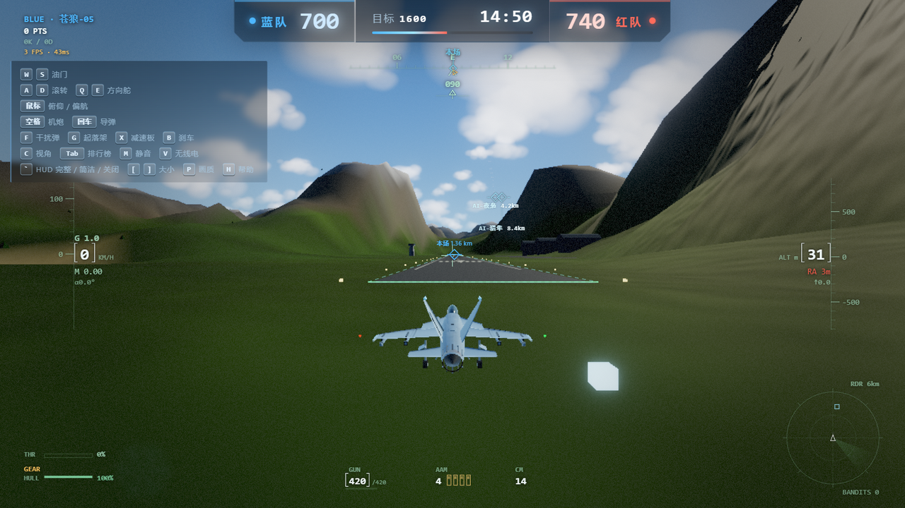

# 云端之刺 · Sky Dogfight

浏览器里的 3D 多人空战。驾驶战机在云海之上缠斗，也可以换乘舰船下海作战。

**2–16 人联机 · 权威服务器 · 打开网页就能玩 · 无客户端**



---

## 玩法

从本方机场跑道滑跑起飞，进入空域后自由爬升、俯冲、翻滚，用机炮与导弹咬住对手的六点钟方向。

地图是 12km × 12km 的开阔空域，散布着两座机场。被击落后会回到本方机场重生——所以守住机场上空，往往比追人头更重要。

水面上还有可驾驶的舰船。贴近水面换乘后，战斗会从三维空域压到海面，主炮与鱼雷的节奏和空战完全不同。

团队模式按击落数计分，先到分数上限的一方获胜。

**这不是街机式空战。** 速度过低会掉高度，迎角过大会进入失速，俯冲会加速、爬升会掉速。想咬住对手得靠能量管理，而不是猛拉杆。

## 这里有什么

一个不依赖任何游戏引擎编辑器、纯手写的空战项目。`Three.js` 负责渲染，飞行力学、命中判定、状态同步全部自己实现。

| | |
|---|---|
| **飞行物理** | `flight-physics.js`（约 1,300 行）实现滚转、俯仰、失速、能量管理。爬升掉速、俯冲加速、低速大迎角失速下坠，都按真实气动趋势调校 |
| **海战模式** | `naval-physics.js`（约 1,200 行）单独一套舰船动力学：排水量、转向半径、惯性漂移，与空战共用同一套同步框架 |
| **权威服务器** | `server.js`（约 1,900 行）。位置、弹道、命中全部服务端结算，客户端只上报输入和做插值预测 |
| **AI 机群** | `bots.js` 提供可配置的 AI 对手，能狗斗、能逃逸，用来填充房间或本地测试 |
| **程序化场景** | 云海、天空、海面、后处理全部程序化生成 —— 仓库里没有一张贴图。克隆下来就有完整画面 |

## 同一个物理，跑在两端

这是这个项目最主要的设计决策：

```
        ┌──────────────────┐
        │ flight-physics.js│  ← 唯一的一份
        └────────┬─────────┘
                 │
      ┌──────────┴──────────┐
      ▼                     ▼
  server.js             public/game.js
  (权威结算)             (预测 + 插值)
```

服务端和客户端 `require` / `import` 的是同一个物理文件。好处是客户端预测和服务器结算不会因为两套实现而有偏差；代价是物理代码必须保持纯函数、不碰 DOM 和网络。

改飞行手感只需要动一个文件，两端同时生效。

## 快速开始

需要 **Node.js 18+**。

```bash
npm install
npm start
# → http://localhost:3000
```

改端口：`PORT=8080 npm start`

## 操作

进入游戏后点击画面锁定鼠标，鼠标控制机头指向。

| 按键 | 功能 |
|---|---|
| 鼠标 | 控制飞行姿态（俯仰 / 滚转） |
| `W` / `S` | 加油门 / 收油门 |
| `A` / `D` | 方向舵偏航 |
| 左键 / `空格` | 机炮开火 |
| `X` | 发射导弹 |
| `R` | 重置机体 |
| `V` | 切换视角 |
| `ESC` | 解除鼠标锁定 |

换乘舰船后操作会切换为舰船模式：主炮、鱼雷与空战完全不同。

## 目录

```
sky-dogfight/
├── server.js            # 权威服务器：房间、同步、命中结算
├── flight-physics.js    # 飞行力学（服务端与客户端共用）
├── naval-physics.js     # 舰船动力学
├── bots.js              # AI 对手
├── public/
│   ├── game.js          # 客户端主逻辑（渲染、输入、插值）
│   ├── hd-sky.js        # 程序化天空
│   ├── hd-clouds.js     # 体积云
│   ├── hd-ocean.js      # 海面
│   └── hd-postfx.js     # 后处理
└── docs/                # 截图
```

## 授权

代码 MIT。可直接用于商业项目。

场景与模型均为程序化生成，无第三方素材依赖。

---

这个项目是 [AI Arcade](../README.md) 合集的一部分，也可以独立运行。
