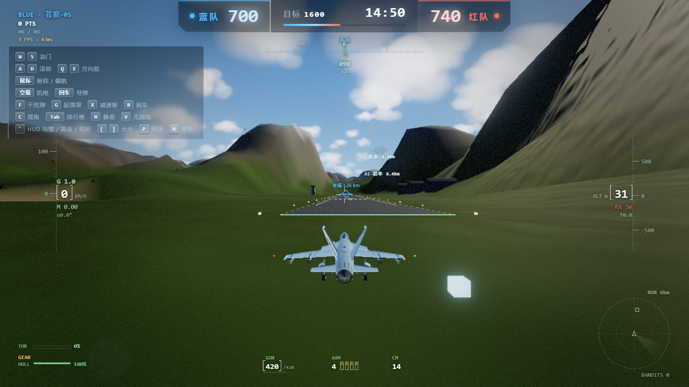

# AI Arcade

**Seven 3D browser games, each fully independent. `cd` in, `npm start`, play.**

Node.js + Three.js + authoritative WebSocket servers · no client install · no build step

[中文](README.md) | English



---

## What this is

A collection of seven browser games built with heavy AI assistance. Each one ships its own authoritative server and multiplayer logic. **They share no code** — pick any directory and run it alone.

These aren't prototypes. Each has real server-side physics, room handling, and state sync.

| Game | Genre | Players | What's interesting |
|---|---|---|---|
| ✈ **Sky Dogfight** | Aerial combat | 2–16 | Flight dynamics synced frame-by-frame server-side. Roll, stall, gun ballistics tuned to real-aircraft feel |
| 🚴 **Nbike Alpine** | Cycling race | 2–12 | Tour-style mountain descent. Drafting, slipstream, gradient and air drag all computed on the server |
| 💩 **Poop Hero** | Arena brawl | 2–12 | 3D arena combat. 60Hz server logic frames for hit detection; dodge rolls counted per frame |
| 🏁 **Mountain Pass Legend** | Drift racing | 2–10 | Night downhill. Dependency-free custom WebSocket sync; tire slip and inertia drift solved server-side |
| ⚽ **Violent Soccer** | Football | 2–12 | Third-person football with slide tackles and bicycle kicks. 30Hz authoritative ball physics |
| 🪖 **Strike Force Heroes** | Side-scrolling shooter | 2–12 | Four classes, dozens of weapons, three multi-layer maps. 60Hz authoritative simulation |
| 🚗 **Immersive Drive** | Cockpit driving | 1 | First-person cockpit with live gauges, steering wheel and mirrors. Pure client-side |

## Quick start

Requires **Node.js 18+**. Every game is a standalone project.

```bash
cd Nbike              # any game directory
npm install
npm start
# open http://localhost:3000
```

| Game | Directory | Dependencies | Default port |
|---|---|---|---|
| Sky Dogfight | `Cloud Thorn/sky-dogfight` | `npm install` | 3000 |
| Nbike Alpine | `Nbike` | `npm install` | 3000 |
| Poop Hero | `便便英雄` | `npm install` | 3000 |
| Mountain Pass Legend | `山路传说` | `npm install` | 3000 |
| Violent Soccer | `足球盛宴` | `npm install` | 3000 |
| Strike Force Heroes | `战火英雄` | `npm install` | 3000 |
| Immersive Drive | `沉浸驾驶` | **none** — just `npm start` | 3000 |

Ports collide by default, so run several with:

```bash
PORT=3001 npm start
```

`Immersive Drive` is purely client-side. It still ships a tiny static server because its `index.html` uses ES modules, which browsers refuse to load over `file://`.

## Try it online

`Immersive Drive` runs on GitHub Pages — **[play it here](https://1441662404.github.io/ai-arcade/)**.

The other six need a Node process, so they must be run locally or deployed to a Node host (Vercel, Railway, Fly.io, a VPS).

## Architecture

```
   Browser ◀──── WebSocket ────▶ Game server (one process per game)
                                      │
                              Authoritative: position / collision / hits
                              Client sends input only; interpolates & predicts
```

Shared design choices:

- **Authoritative server** — position, collision and hit detection are all resolved server-side. Prevents cheating and avoids two implementations drifting apart.
- **State sync, not RPC** — the server broadcasts world snapshots at a fixed tick; clients interpolate and predict.
- **Zero external assets** (some games) — Sky Dogfight and Immersive Drive generate every model, sky and ocean procedurally. Not a single texture in the repo.
- **No build step** — no bundler. Edit a `.js` file, refresh the browser. This is deliberate: these games live or die on feel, and tuning feel requires a zero-latency edit loop.

## On AI-assisted development

The code here was largely written by AI coding assistants. A human set direction, tuned feel, and judged what was fun.

The honest takeaway: **writing code is no longer the bottleneck — knowing what's fun is.** Not a single physics value (grip, jump height, camera damping) came out right on the first try. Those tables were adjusted over dozens of playtests. AI is excellent at turning "I know what I want" into running code. It cannot tell you whether the result feels good.

Which is why the real value in this repo may not be the code, but the parameter tables inside it.

## Assets and licensing

**Code**: MIT, see [LICENSE](LICENSE). Free to use, modify, and sell.

**Art and audio**: more complicated — please read.

- Some 3D models and animation data come from public asset libraries (Mixamo, Kenney, Quaternius) or third-party packs. **Copyright remains with the original authors**; they are redistributed here for demonstration only.
- Real-player celebration audio and player likenesses in `Violent Soccer` were **removed from this repository**. To restore the feature, supply your own audio as `足球盛宴/audio/cheer-1.mp3` and `cheer-2.mp3` — the code skips missing files silently.
- Vehicle models in `Mountain Pass Legend` are independent 3D assets, unrelated to any anime or film. Game title, place names, driver names and chassis codes have all been made original.
- If you are a rights holder and object to any asset here, open an issue and it will be removed promptly.

**In practice**: use the code freely, but **do not commercially reuse the art assets** as-is. Replace them with your own.

## Contributing

See [CONTRIBUTING.md](CONTRIBUTING.md). Short version: each game is independent, there is no build step, and never commit assets you don't have the rights to.
