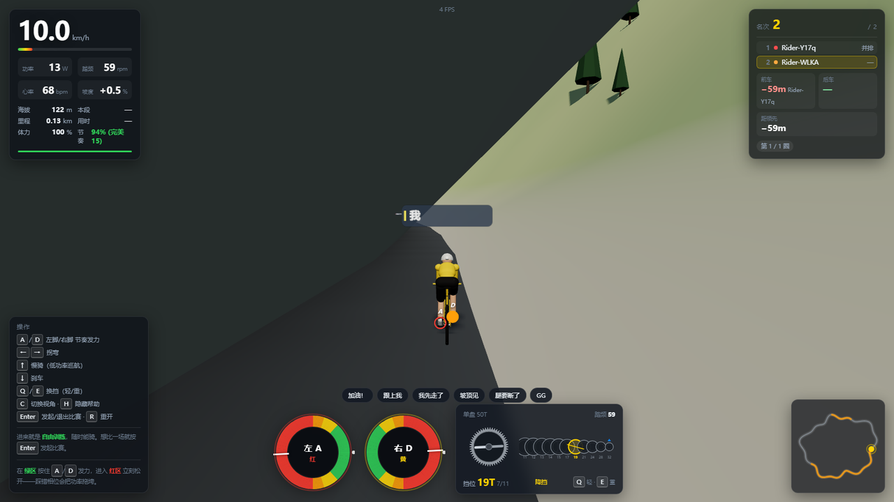
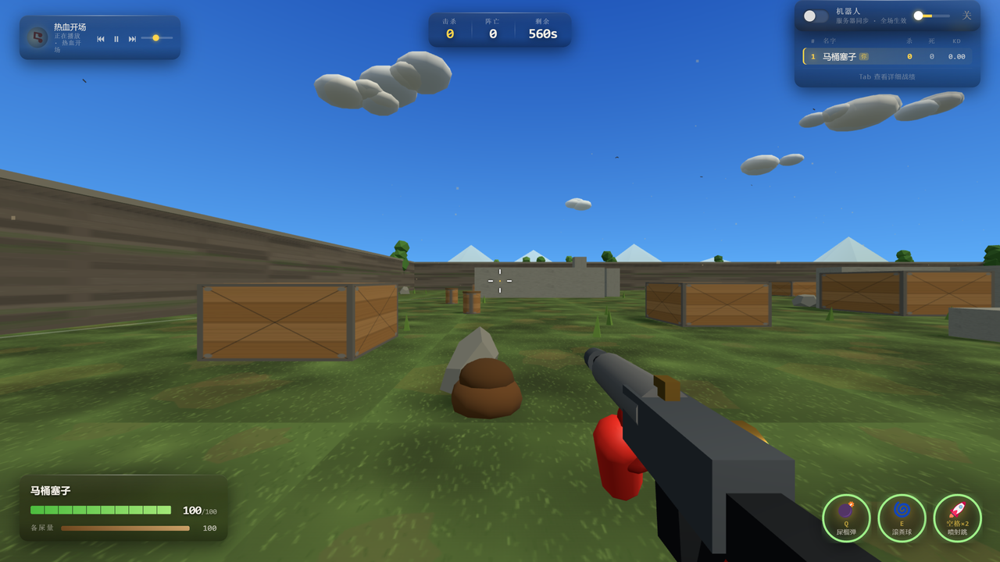
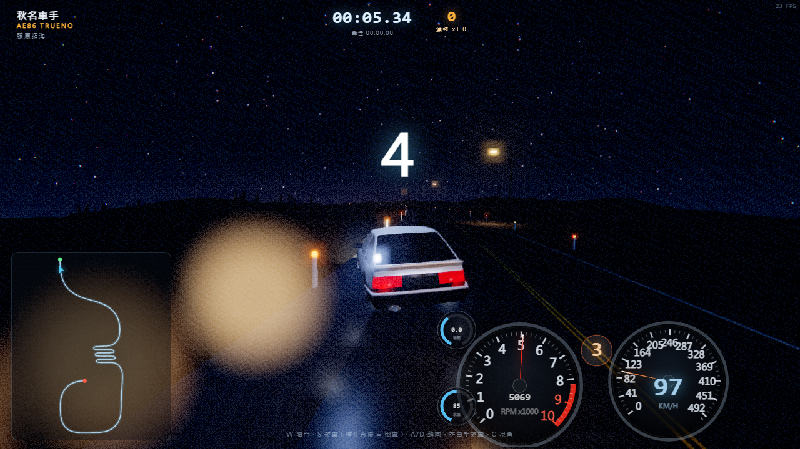
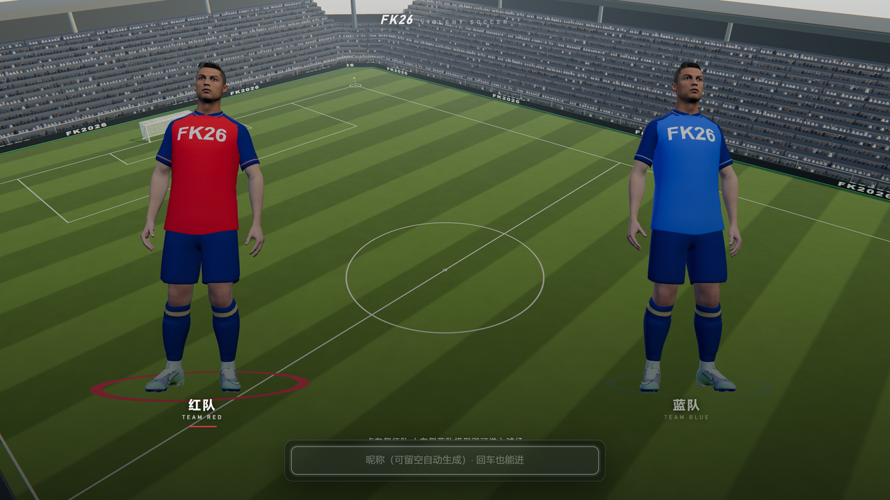
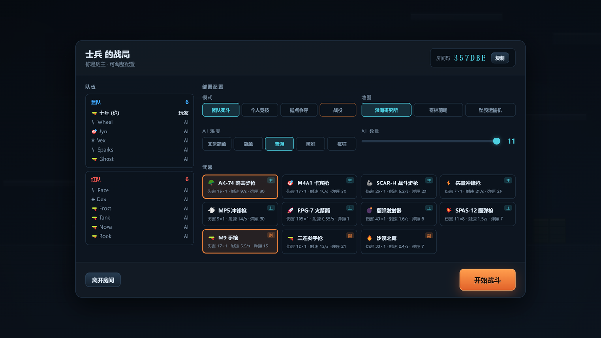
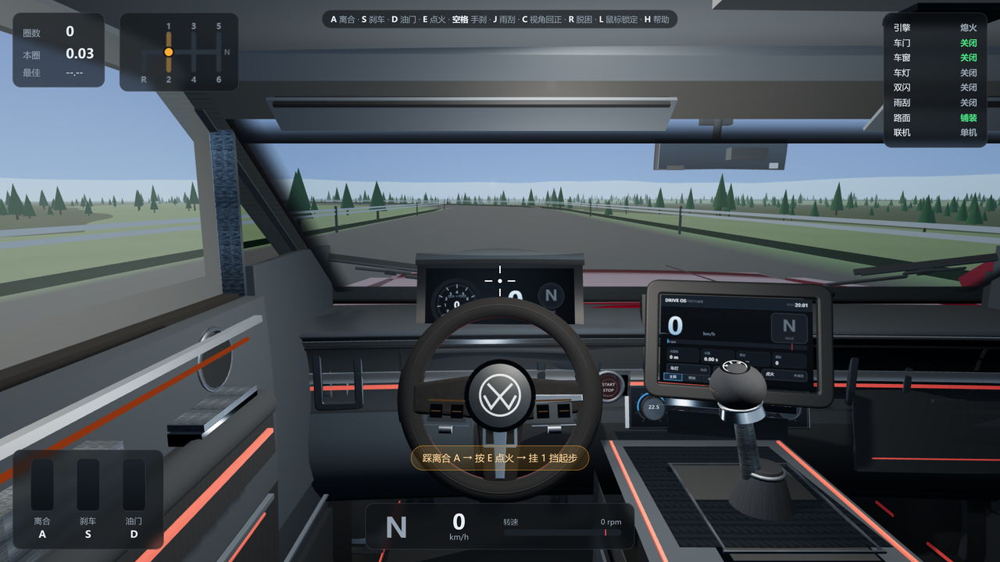

<div align="center">

# AI Arcade

**七款能联机的 3D 网页游戏，各自独立，进目录就能跑。**

Node.js + Three.js + WebSocket 权威服务器 · 浏览器直接开打 · 无需安装客户端

[English](README.en.md) | 简体中文 · [在线试玩](https://1441662404.github.io/ai-arcade/)

</div>

---

## 七款游戏

### ✈ 云端之刺 · Sky Dogfight


**空战 · 团队对抗 · 2–16 人**

驾驶战机在云海之上缠斗，也可换乘舰船下海作战。权威服务器逐帧同步飞行物理，滚转、失速、机炮与导弹都按真机手感调校。

```bash
cd "Cloud Thorn/sky-dogfight" && npm install && npm start
```

---

### 🚴 山道飞骑 · Nbike Alpine



**自行车竞速 · 2–12 人**

写实风环法式山道速降。摇车、卡位、跟车吸尾流，坡道地形与空气阻力全部由服务端物理推演，冲线那一刻才见分晓。

```bash
cd Nbike && npm install && npm start
```

---

### 💩 便便英雄 · Poop Hero



**竞技场乱斗 · 2–12 人**

3D 竞技场混战，跳跃、冲刺、投掷与技能连招。服务端 60Hz 逻辑帧负责命中判定，翻滚闪避的每一帧都算数。

```bash
cd 便便英雄 && npm install && npm start
```

---

### 🏁 山路传说 · Mountain Pass Legend



**漂移夜战 · 2–10 人**

雾见山下坡夜战。零依赖自研 WebSocket 同步，轮胎打滑与惯性漂移都在服务器演算，五连发夹弯见真章。

```bash
cd 山路传说 && npm install && npm start
```

---

### ⚽ 足球盛宴 · Violent Soccer



**足球对抗 · 2–12 人**

3D 第三人称暴力足球，铲抢、冲撞、倒钩样样来。30Hz 权威主循环驱动的球体物理，支持观战与语音。

```bash
cd 足球盛宴 && npm install && npm start
```

---

### 🪖 战火英雄 · Strike Force Heroes



**横版射击 · 2–12 人**

经典 2D 横版射击。四大兵种、数十种枪械、三张多层地图。服务端权威 60Hz 推演，最多 12 人同房，支持 5 人组队开黑。

```bash
cd 战火英雄 && npm install && npm start
```

---

### 🚗 沉浸驾驶 · Immersive Drive



**第一人称座舱 · 单机**

第一人称座舱视角的山路驾驶体验，仪表、方向盘与后视镜实时联动，电台可选 Eurobeat 歌单。**纯前端应用，唯一可以在线玩的一款。**

[**▶ 在线试玩**](https://1441662404.github.io/ai-arcade/drive/) 或者本地：

```bash
cd 沉浸驾驶 && npm start
```

---

## 快速开始

需要 **Node.js 18+**。每款游戏都是独立项目，进目录即可运行。

```bash
cd Nbike              # 换成你想玩的任意目录
npm install
npm start
# 浏览器打开 http://localhost:3000
```

| 游戏 | 目录 | 依赖 |
|---|---|---|
| 云端之刺 | `Cloud Thorn/sky-dogfight` | 需 `npm install` |
| 山道飞骑 | `Nbike` | 需 `npm install` |
| 便便英雄 | `便便英雄` | 需 `npm install` |
| 山路传说 | `山路传说` | 需 `npm install` |
| 足球盛宴 | `足球盛宴` | 需 `npm install` |
| 战火英雄 | `战火英雄` | 需 `npm install` |
| 沉浸驾驶 | `沉浸驾驶` | **零依赖**，直接 `npm start` |

默认端口都是 3000。想同时开两款，用 `PORT` 区分：

```bash
PORT=3001 npm start
```

## 技术架构

```
   浏览器 ◀──── WebSocket ────▶ 游戏服务端（每款一个独立进程）
                                    │
                            权威结算：位置 / 碰撞 / 命中
                            客户端只发输入，做插值与预测
```

共同的设计取舍：

- **权威服务器**：位置、碰撞、命中全部服务端结算，客户端只发输入。避免作弊，也避免两端算错。
- **状态同步而非 RPC**：服务端以固定 tick 广播世界快照，客户端做插值与预测。
- **零外部资源依赖**（部分项目）：`云端之刺` 与 `沉浸驾驶` 的模型、天空、海面均为程序化生成，仓库里没有一张贴图。
- **无构建步骤**：没有打包器。改完 JS 刷新浏览器就生效，适合快速迭代。

## 项目结构

```
.
├── Cloud Thorn/sky-dogfight/   # 云端之刺（空战）
├── Nbike/                      # 山道飞骑（自行车竞速）
├── 便便英雄/                    # Poop Hero（竞技场乱斗）
├── 山路传说/                    # Mountain Pass Legend（漂移夜战）
├── 足球盛宴/                    # Violent Soccer（足球对抗）
├── 战火英雄/                    # Strike Force Heroes（横版射击）
├── 沉浸驾驶/                    # Immersive Drive（单机座舱驾驶）
└── docs/                       # 展示页与截图（GitHub Pages 源）
```

## 关于 AI 开发

这七款游戏的代码主要由 AI 编程助手生成，人负责定方向、调手感、验收。

实际体验是：**写代码已经不是瓶颈了，判断什么好玩才是。** 物理参数（抓地力、跳跃高度、镜头跟随的阻尼）没有一个能靠 AI 一次调对，全靠反复试玩改数值。AI 擅长的是把「我知道要什么效果」快速变成能跑的代码，不擅长告诉你「这个手感对不对」。

所以这个仓库真正的价值可能不是代码本身，而是里面那些调过几十遍的参数表。

## 素材与授权

**代码**：MIT，见 [LICENSE](LICENSE)。可自由使用、修改、商用。

**美术与音频素材**：情况较复杂，请务必阅读。

- 部分 3D 模型与动作数据来自公开资源站（Mixamo、Kenney、Quaternius 等）或第三方素材包，**版权归各自原作者**，本仓库仅作技术演示用途分发。
- `足球盛宴` 的球员庆祝语音、指向真实球员的模型、以及球衣上的赞助商与俱乐部队徽，**均已移除或替换**。想恢复语音，请自行放入 `足球盛宴/audio/cheer-1.mp3` 与 `cheer-2.mp3`（文件缺失时静默跳过，不影响运行）。
- `山路传说` 中的车辆模型为独立 3D 资产，与任何动漫、影视作品无关；游戏名、地名、车手名、车型代号均已原创化。
- 若您是权利人，认为某处素材使用不当，请开 issue 或联系维护者，我们会立即移除。

**结论**：代码可以放心用，美术资源请自行确认授权后再商用。

---

<div align="center">

如果这些代码对你有用，给个 star 就是最好的支持。

</div>
