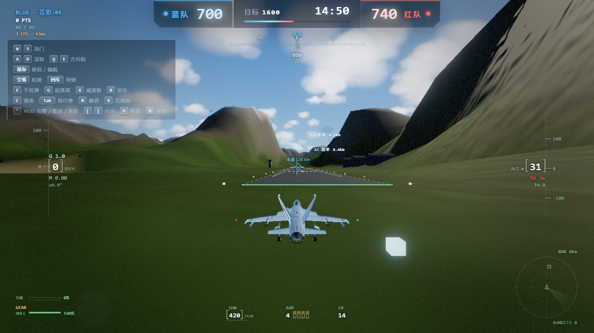

<div align="center">

# AI Arcade

**七款能联机的 3D 网页游戏，各自独立，进目录就能跑。**

Node.js + Three.js + WebSocket 权威服务器 · 浏览器直接开打 · 无需安装客户端



</div>

---

## 这是什么

一个用 AI 辅助开发完成的网页游戏合集。七款游戏，七套独立的权威服务器，**互不依赖** —— 想玩哪款就进哪个目录，不需要大厅、不需要总控服务。

不是 Demo，不是原型。每款都有真实的服务端物理推演、房间匹配和多人同步。

| 游戏 | 类型 | 人数 | 技术看点 |
|---|---|---|---|
| ✈ **云端之刺**<br>Sky Dogfight | 空战 · 团队对抗 | 2–16 | 服务端逐帧同步飞行动力学，滚转/失速/机炮按真机手感调校；可换乘舰船下海 |
| 🚴 **山道飞骑**<br>Nbike Alpine | 自行车 · 竞速 | 2–12 | 环法式山道速降，摇车、卡位、跟车吸尾流，坡度与空气阻力由服务端推演 |
| 💩 **便便英雄**<br>Poop Hero | 竞技场 · 乱斗 | 2–12 | 3D 竞技场混战，60Hz 逻辑帧做命中判定，翻滚闪避逐帧计算 |
| 🏁 **山路传说 · 雾见山夜战**<br>Mountain Pass Legend | 漂移 · 夜战 | 2–10 | 零依赖自研 WebSocket 同步，轮胎打滑与惯性漂移在服务器演算 |
| ⚽ **足球盛宴**<br>Violent Soccer | 足球 · 对抗 | 2–12 | 30Hz 权威主循环驱动球体物理，支持观战与语音 |
| 🪖 **战火英雄**<br>Strike Force Heroes | 横版射击 · 组队 | 2–12 | 四大兵种、数十种枪械、三张多层地图，60Hz 权威推演 |
| 🚗 **沉浸驾驶**<br>Immersive Drive | 驾驶 · 单机 | 1 | 第一人称座舱，仪表、方向盘、后视镜实时联动，内置 Eurobeat 电台 |

## 快速开始

需要 **Node.js 18+**。每款游戏都是独立项目，进目录即可运行。

```bash
cd Nbike              # 换成你想玩的任意游戏目录
npm install
npm start
# 浏览器打开 http://localhost:3000
```

七款的目录与启动方式：

| 游戏 | 目录 | 依赖 | 默认端口 |
|---|---|---|---|
| 云端之刺 | `Cloud Thorn/sky-dogfight` | 需 `npm install` | 3000 |
| 山道飞骑 | `Nbike` | 需 `npm install` | 3000 |
| 便便英雄 | `便便英雄` | 需 `npm install` | 3000 |
| 山路传说 | `山路传说` | 需 `npm install` | 3000 |
| 足球盛宴 | `足球盛宴` | 需 `npm install` | 3000 |
| 战火英雄 | `战火英雄` | 需 `npm install` | 3000 |
| 沉浸驾驶 | `沉浸驾驶` | **零依赖**，`npm start` 直接跑 | 3000 |

因为默认端口都是 3000，**想同时开两款**就指定不同端口：

```bash
PORT=3001 npm start
```

`沉浸驾驶` 是纯前端应用（无权威服务端），但仍需要一个本地服务器 —— 它的 `index.html` 用了 ES Module，浏览器在 `file://` 下会因 CORS 拒绝加载 Three.js，所以附了一个零依赖静态服务器。

## 各款的独立性

七款之间没有任何代码依赖，可以单独拿走任意一款：

- 每款自带 `package.json`、入口文件和依赖声明
- 想拆成独立仓库，直接把对应目录 `git init` 即可
- 想部署，每款就是一个普通 Node 应用（`沉浸驾驶` 是纯静态）

## 技术架构

```
   浏览器 ◀──── WebSocket ────▶ 游戏服务端（每款一个独立进程）
                                    │
                            权威结算：位置 / 碰撞 / 命中
                            客户端只发输入，做插值与预测
```

共同的设计取舍：

- **权威服务器**：位置、碰撞、命中全部服务端结算，客户端只发输入。避免作弊，也避免两端算错。
- **状态同步而非 RPC**：服务端以固定 tick 广播世界快照，客户端做插值与预测。
- **零外部资源依赖**（部分项目）：`云端之刺` 与 `沉浸驾驶` 的模型、天空、海面均为程序化生成，仓库里没有一张贴图。
- **无构建步骤**：没有打包器。改完 JS 刷新浏览器就生效，适合快速迭代。

## 项目结构

```
.
├── Cloud Thorn/sky-dogfight/   # 云端之刺（空战）
├── Nbike/                      # 山道飞骑（自行车竞速）
├── 便便英雄/                    # Poop Hero（竞技场乱斗）
├── 山路传说/                    # Mountain Pass Legend（漂移夜战）
├── 足球盛宴/                    # Violent Soccer（足球对抗）
├── 战火英雄/                    # Strike Force Heroes（横版射击）
├── 沉浸驾驶/                    # Immersive Drive（单机座舱驾驶）
└── docs/screenshots/           # README 配图
```

## 关于 AI 开发

这七款游戏的代码主要由 AI 编程助手生成，人负责定方向、调手感、验收。

实际体验是：**写代码已经不是瓶颈了，判断什么好玩才是。** 物理参数（抓地力、跳跃高度、镜头跟随的阻尼）没有一个能靠 AI 一次调对，全靠反复试玩改数值。AI 擅长的是把「我知道要什么效果」快速变成能跑的代码，不擅长告诉你「这个手感对不对」。

所以这个仓库真正的价值可能不是代码本身，而是里面那些调过几十遍的参数表。

## 素材与授权

**代码**：MIT，见 [LICENSE](LICENSE)。可自由使用、修改、商用。

**美术与音频素材**：情况较复杂，请务必阅读。

- 部分 3D 模型与动作数据来自公开资源站（Mixamo、Kenney、Quaternius 等）或第三方素材包，**版权归各自原作者**，本仓库仅作技术演示用途分发。
- `足球盛宴` 的球员庆祝语音、以及指向真实球员的模型，**已从仓库中移除**。想恢复该功能，请自行准备音频放入 `足球盛宴/audio/`，命名 `cheer-1.mp3` 与 `cheer-2.mp3`（代码中缺失文件会静默跳过，不影响游戏运行）。
- `山路传说` 中的车辆模型为独立 3D 资产，与任何动漫、影视作品无关；游戏名、地名、车手名、车型代号均已原创化。
- 若您是权利人，认为某处素材使用不当，请开 issue 或联系维护者，我们会立即移除。

**这是什么意思**：你可以放心用这些代码，但**不要直接商用里面的美术资源**。要商用请替换成自有素材。

---

<div align="center">

如果这些代码对你有用，给个 star 就是最好的支持。

</div>
